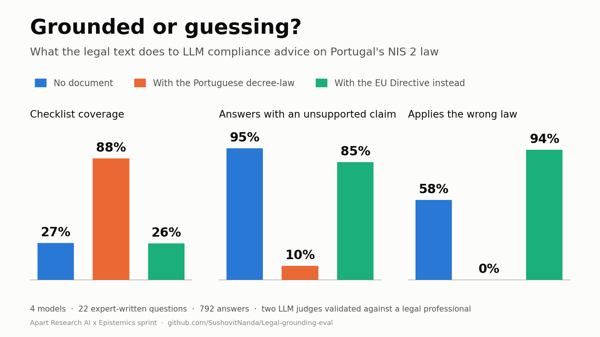

# Grounded or guessing? LLM compliance advice under Portugal's NIS 2 transposition

Code, data and results for our submission to the Apart Research **AI x Epistemics** sprint (13-15 Nov
2026), Track 1. Authors: Beatriz Lourenço and Sushovit Nanda.

We ask language models compliance questions about Decreto-Lei n.º 125/2025, Portugal's transposition of
the NIS 2 Directive, published after the training cutoffs of the models we test. Each question is asked
three ways: with no document (C0), with the official text of the decree-law (C1), and with the Directive
instead of the decree-law (C2). Every answer is scored against a checklist written by a legal
professional for what it covers, what it states without support in the law, whether it applies the
wrong legal instrument, and whether it says what is uncertain.



**Report:** [`Report/NIS2-compliance-advice-report.pdf`](Report/NIS2-compliance-advice-report.pdf)
(and `.docx`).

## Main result

Three models (qwen3.5-397b, gemma-4-31b-it, deepseek-v4-flash), 594 answers, graded by qwen3.8-27b;
means over 22 questions with 95% bootstrap intervals over questions.

| | C0: question only | C1: with the decree-law | C2: with the Directive instead |
|---|---|---|---|
| Checklist coverage | 27% [19, 35] | 88% [81, 94] | 26% [17, 38] |
| Answers with at least one unsupported claim | 95% [86, 100] | 10% [5, 17] | 85% [77, 92] |
| Answers with jurisdiction confusion | 58% [46, 68] | 0% | 94% [90, 97] |
| Says the decree does not settle the point (3 questions) | 30% [11, 56] | 100% | 11% [0, 22] |
| Says the text given is not the Portuguese law | 0% | 0% | 14% [9, 19] |

- **The right text turns guessing into grounded advice.** Without it, no answer names the decree-law;
  58% rest on the regime it repealed and 58% name some other statute as the transposition.
- **A related, official, wrong text looks like success.** Under C2 the cited Directive articles are real
  (3% do not exist), but 94% of answers apply the Directive as Portuguese law. A directive binds the
  Member State, not the company, so it is not a legal basis for a company's duties.
- **Uncertainty is flagged where the text signals it,** and not where it comes from reasoning (a date
  calculation, an ambiguous provision).
- **The judges are validated twice.** A second judge from another family (gemma-4-31b-it) graded all
  answers again (Cohen's kappa 0.83 on coverage, 0.86 on unsupported claims); the author of the standard
  graded a blind sample of 25 answers (kappa 0.64 to 0.71 on coverage, 0.64 to 0.92 on the answer-level
  marks) and finds the same pattern on her own.

Every table: `results/full/RESULTS_tables.md`; the human check: `results/full/blind/human_results.md`.

## Reproduce

```bash
pip install -r requirements.txt
python -m unittest discover -s tests          # 34 tests, no network
python -m nis2eval validate                   # the standard: schema, citations, evidence excerpts on their page

# rebuild every table, figure, agreement table and the report from the stored answers (no model calls)
python scripts/refresh_results.py
powershell -ExecutionPolicy Bypass -File scripts\check_report.ps1   # Windows + Word: 8-page check and PDF

# the full run itself (needs an Adaption API key in .env as  adaption_api_key = ...)
python scripts/overnight.py --no-stretch      # resumable: finished answers and judgments are skipped
```

`python -m nis2eval demo` runs the whole pipeline offline on mock models (synthetic, not results).

## The full run

| Order | What | Size |
|---|---|---|
| 1 | Four core models, C0 / C1 / C2, 3 repetitions each; first repetition, then the blind sample of 25, then the other two | 792 answers |
| 2 | Main judge `qwen3.8-27b` grades the core; main result analysed | 792 judgments |
| 3 | Second judge `gemma-4-31b-it` grades the core again; agreement between the judges | 792 judgments |
| 4 | Supplementary model `gemma-4-26b-a4b-it`, graded by both judges | 198 answers |
| 5 | Blind sample graded by the author of the standard; judge-versus-human agreement | 25 answers |

- **Checkpoints.** Every answer and judgment is appended to `results/full/answers.jsonl` /
  `judgments.jsonl` when it arrives; rerunning skips what is there. A reworded question is asked again
  and a revised checklist is graded again, only where it changed (`tests/test_resume.py`).
- **Rate limit (measured 15 Nov 2026).** One limit per Adaption account for all keys and models, and it
  follows prompt size: about 15 short calls a minute, about 4 calls carrying the 50,000-token decree.
  The client paces itself by input tokens per minute and adjusts on HTTP 429.

## What is in the repository

| Path | What it is |
|---|---|
| `Report/` | The submission report (`.docx`, `.pdf`) and the Apart template it is built from (`scripts/build_report.py`) |
| `data/decree/` | Official PDF of the decree-law, its clean text (one form feed per page) and an index that keeps the decree's own articles apart from the annexed regime |
| `data/decree/translation/` | An unofficial English translation of the decree-law, reading aid only (see its README) |
| `data/directive/` | Directive (EU) 2022/2555: official Portuguese text without recitals (the C2 document), official English PDF and text, index |
| `data/standard/` | The reference standard (`standard.json`, generated from `source/`), the rubric, and the author's original JSON and checker |
| `data/stretch/` | A scheme of legal categories for a follow-up condition (see report Appendix K) |
| `config/models.json` | Models, judges, generation settings and notes on the API |
| `nis2eval/` | The pipeline: citation parser and indexes, prompts and conditions, resumable runner, judge and scorer, analysis, blind sample and agreement |
| `scripts/` | Full run (`overnight.py`), result tables, figure, judge and human agreement, report build and check, data extraction |
| `results/` | The main run and the pilot: all answers and judgments, score tables, analyses, the blind sample with the human grades; see `results/README.md` |
| `docs/` | Methods and Results drafts that the report text was written from |
| `tests/` | Parser, index, standard, scoring and resume tests |

The API key lives only in `.env`, which is git-ignored. One file is not ours to publish and is
also ignored: the signed statement on the translation review (it carries a personal identification
number).

## Design

**Conditions** (identical wording apart from the document block; document first, so providers can cache it):

| | The model receives |
|---|---|
| C0 | the question only |
| C1 | the official text of DL 125/2025 + the question |
| C2 | Directive (EU) 2022/2555 **instead of** the decree-law, labelled honestly as the directive + the question |
| C4 (designed for follow-up work) | the decree-law + a scheme of legal categories + the question |
| C3 (designed for follow-up work) | the pre-existing compliance artifact + the question |
| `C0p`, `C1p` (designed for follow-up work) | the model's own answer, then a user pushback asserting the directive's deadlines |

The prompt asks for a complete answer with its legal basis. It does **not** ask the model to flag
uncertainty, because that is the behaviour being measured.

**Metrics per answer**

| Metric | How |
|---|---|
| Coverage | judge marks each checklist item covered / partial / not covered; mean with partial = 0.5 |
| Unsupported claims | judge lists claims with no support in, or contrary to, the decree-law (the rubric's "fabricated"); a Directive rule stated as Portuguese law is one |
| Non-existent citations | deterministic: every cited article / n.º / alínea is looked up in the index |
| Overconfidence | share of *inferred* / *to confirm* items the answer states as certain |
| Proper flagging | share of those items where the answer says what the point depends on |
| Unwarranted hedging | share of *verified* items presented as doubtful |
| Jurisdiction confusion | judge: directive or repealed regime applied as the law in force. Deterministic support: count of citations attributed to the directive |
| Says the decree is silent | on the 3 questions the decree-law does not answer |
| Notes the source mismatch | the answer says the text it was given is not the Portuguese law (the right behaviour in C2) |

The judge sees the full official text of the decree-law, the question, the checklist with statuses,
the author's grading notes, the text of the cited provisions, and the result of the automatic
citation check. It never sees the model name or the condition.

**Statistics.** The unit is the question (22), not the answer. Repetitions are averaged within a
question first, then questions are resampled (5,000 bootstrap draws) for 95% intervals. Condition
effects are paired differences per question. Variance across repetitions is reported separately.

## Models and training cutoffs

Core test models: `qwen3.5-397b`, `qwen3.8-27b` (same family, about 15x smaller), `gemma-4-31b-it`,
`deepseek-v4-flash`; supplementary: `gemma-4-26b-a4b-it`. Judges: `qwen3.8-27b` (main) and `gemma-4-31b-it`
(second). All called through Adaption's hosted API at reasoning effort "medium", 12,000 output tokens,
temperature 0.7 for answers and 0 for judges.

**Training cutoffs.** The decree-law was published on 4 Dec 2025 and CNCS Regulation 756/2026 on
22 Jun 2026. A model trained before the decree existed cannot know it, so in C0 the question becomes
whether it says so. Asked in the smoke test what DL 125/2025 is, all four test models said they did
not know it. Their self-reported cutoffs are in `config/models.json` but are not reliable (one model
gave two different dates in two runs). From model cards and listings: gemma-4-31b-it January 2025,
qwen3.5-397b April 2025, deepseek-v4-flash May 2025; qwen3.8-27b has none published.

### API settings established in the smoke test (14 Nov 2026)

- **Calls must be streamed.** The gateway answers 504 when no byte arrives within 60 seconds, and the
  models reason for a long time before the first word. `nis2eval/llm.py` streams every call.
- **Reasoning effort.** The API default is `xhigh` (accepted: `xhigh`, `medium`, `low`, `none`).
  Reasoning tokens count against `max_output_tokens`. At `xhigh`, `qwen3.8-27b` spent 12,000 tokens
  reasoning and returned nothing in 6 of 9 dry-run calls. All test models and the judge run at
  `medium` with a 12,000-token budget. `gemma-4-31b-it` did not reason at all with the setting
  omitted and does reason at `medium`, so for that model `medium` is more reasoning than its default.
- **Rate limit.** HTTP 429, "retry after 60 seconds"; on 15 Nov it turned out to be one limit per
  account, not per key (see "The full run").

### How the scoring was validated in the pilot (14 Nov 2026)

- **The judge needs the whole decree.** Shown only the provisions the checklist cites, it marked true
  statements about other provisions as fabricated (art. 11.º of the decree-law itself, art. 30.º,
  n.º 5 of the regime): about 8 of 18 "fabrications" under C1. Judge prompt v2 gives it the full
  official text and explains the two article numberings. Fabricated claims per C1 answer went from
  0.45 to 0.12, and the five that remain are real. Old marks are kept in `judgments.jsonl` but only
  the current prompt version is used.
- **Citations follow the instrument the answer builds on.** An answer that never names DL 125/2025
  and builds on another statute or on the Directive has its bare article references attributed to
  that instrument. Directive citations are checked against the directive index
  (`cit_directive_invalid` in `scores.csv`).
- **`cit_invalid_rate` is only meaningful under C1.** Under C0 and C2 an answer cites DL 125/2025 about
  once on average, so the share rests on almost nothing. Report it for C1 and report counts elsewhere.
- **Claim counts depend on how a judge splits claims.** The main number is the share of answers with at
  least one unsupported claim.

## Getting the directive text (needed for C2)

`python scripts/fetch_directive.py` downloads the Portuguese text (CELEX 32022L2555) and drops the
recitals. EUR-Lex serves scripts a placeholder page, so the script falls back to the Publications
Office (`publications.europa.eu/resource/celex/32022L2555`), which serves the same official text.
If both refuse, save the page from a browser and run
`python scripts/fetch_directive.py --from-html saved.html`. Until the file exists the runner skips
C2 and says so. The text is already in `data/directive/directive-2022-2555-pt.txt` (46 articles).

## Claims that rest on CNCS Regulation 756/2026

The standard is scoped to the decree-law. A correct statement that rests on CNCS Regulation 756/2026
(for example, risk analysis at least once a year) is recorded as `outside_reference_claims`: neither
covered nor unsupported. It counts as unsupported only if the answer attributes it to the decree-law or
contradicts the decree-law. This was the author's decision; switch with
`score --outside-reference fabricated`. The judges see only the decree-law, so they cannot catch an
answer that is wrong about the Regulation; the human grader caught two.

## Pre-existing work and what is new

- **Pre-existing (before the sprint, 18-30 Oct 2026, by B. Lourenço):** an AI artifact built with Claude Pro on
  one company's NIS2 compliance (in Portuguese, not published). It was a source of topics for all 22
  questions and of the four status labels; no question and 2 of 71 checklist items share their opening
  wording with it. It was never given to a model or a judge, it is **not in this repository**, and no code
  from before the sprint is used.
- **New in the sprint:** the reference standard (questions, checklists, statuses, grading notes),
  the rubric, and all code and results in this repository.
- **AI assistance:** the code was written with Claude and reviewed by us. The checklists were drafted
  with AI assistance and checked against the decree by the author of the standard; every citation is also re-checked by
  `python -m nis2eval validate` (article, paragraph and point exist; the quoted excerpt is on the cited page).

## Limitations

- One statute, one jurisdiction, 22 questions; one human grader, who also wrote the standard.
- Only 11 of 71 items are *inferred* or *to confirm*, so the uncertainty metrics have wide intervals;
  the human sample has too few uncertain marks (8) to check the judges on them.
- Both judges are LLMs and both are test models; levels without a document depend on the judge, the
  contrasts between conditions do not.
- The decree-law is public; models trained after December 2025 may have seen it.
- The pilot asked 15 questions in a provisional Portuguese translation; pilot and full-run numbers are
  not pooled.
- The company behind the case that informed the questions is not named anywhere in this repository.
- Not legal advice. The standard is a checked reading of the decree-law, not an opinion of the CNCS.

## Notes on the decree text

The official PDF maps the letters "i" and "v" to private-use glyphs, so copy/paste and `pdftotext`
drop them ("ncdente sgnfcato"). `scripts/extract_decree_text.py` reads the glyphs with pdfplumber
and maps them back; nothing is OCR'd. The tests check that no unmapped glyph remains and that all
11 + 87 + 2 articles are found.

## Figures

Bars are coloured by condition in a fixed order (blue C0, orange C1, aqua C2). The three colours pass
a colour-blind separation check; the same numbers are always available as tables in
`analysis/summary.md`.

## License and citation

Code: MIT (`LICENSE`). Our data, results, report and documents: CC BY 4.0 (`LICENSE-DATA.md`). The official
texts of the decree-law and the Directive and the Apart template keep their own terms (see `LICENSE-DATA.md`).

```
Lourenço, B. and Nanda, S. (2026). Grounded or Guessing? What the Legal Text Does to LLM Compliance Advice
on Portugal's NIS 2 Transposition. Apart Research AI x Epistemics Research Sprint.
```

Not legal advice: the material serves to evaluate language models.
